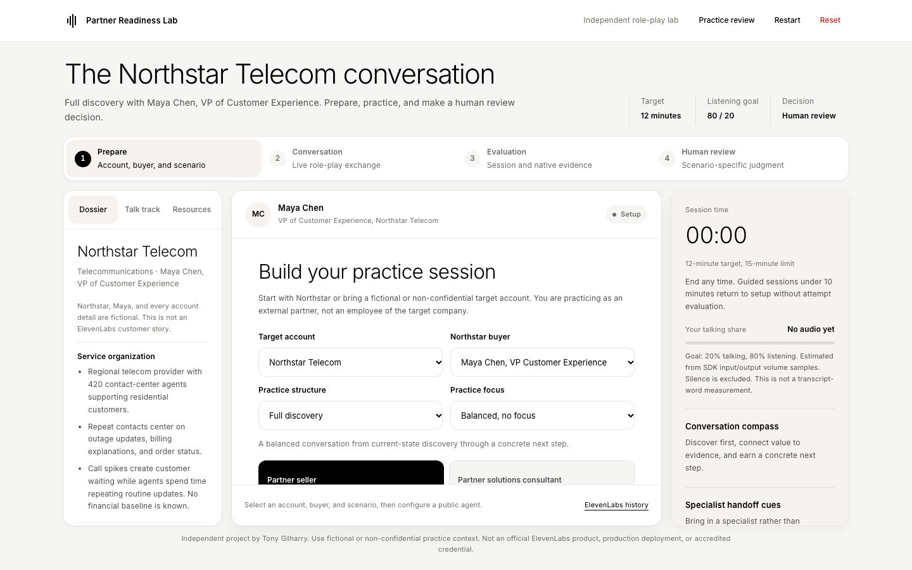

# Partner Readiness Lab

A local-first voice role-play lab for partner sellers and partner solutions consultants. Practice with Northstar Telecom executives or bring a fictional or non-confidential target company, buyer persona, and product/service offer. The app combines live ElevenLabs conversations, transparent local coaching, evidence rubrics, and optional human review.

This independent project is not an official ElevenLabs product, production deployment, or accredited credential.

## Screenshots



- [Custom scenario workspace](docs/screenshots/custom-scenario-desktop.png)
- [Mobile practice setup](docs/screenshots/mobile-setup.png)

Screenshots show the local interface with fictional practice context. They are not evidence of live ElevenLabs sessions.

## What is included

- Three Northstar buyers: Maya Chen, VP of Customer Experience; Daniel Okafor, CTO; and Priya Raman, CISO. Each has distinct priorities, concerns, coaching, evidence, and review criteria.
- Custom target companies and industries from pasted text or `.md` / `.txt` files, plus a separate buyer persona and the product/service you sell.
- Five professional practice structures: Full discovery, Qualification and value, Technical validation and handoff, Objection handling and proof, and Customer escalation and recovery.
- Optional MEDDPICC, Command of the Message, and technical-discovery practice focuses. These are lenses, not linear stages or scripts to recite.
- Guided review with local evidence and a human decision, or Free practice with no evidence score, evaluation gate, or completion claim.
- Plain-Markdown scenario-pack import and export for sharing a target account, buyer, offer, objective, scenario, track, and focus.
- Live voice through the official `@elevenlabs/client` SDK, one editable verbatim script, transcript, text messaging, volume-based listening estimate, and local print records.

## Quick start

Requires Node.js `^20.19.0` or `>=22.12.0`, a modern browser, and your own ElevenLabs account.

1. Clone and install:

   ```bash
   git clone https://github.com/tony-gilharry/partner-readiness-lab.git
   cd partner-readiness-lab
   npm install
   ```

2. Follow [`agent/README.md`](agent/README.md) to create dedicated public demo agents. Use one agent and distinct configured voice for each built-in buyer, plus a generic agent for custom buyers. Copy public agent IDs only, never API keys.
3. Start the app:

   ```bash
   npm run dev
   ```

4. Open http://127.0.0.1:8765. Select an account, buyer, practice structure, and mode. Configure the matching public agent ID and start when you are ready to use your microphone.

Development and preview default to port 8765. To use another port:

```bash
npm run dev -- --port 8871
npm run build
npm run preview -- --port 8872
```

Usage charges, audio, transcripts, native evaluation, and retention are governed by your ElevenLabs account and settings. The legacy static Northstar-only version remains in `static/`. `python3 server.py` serves only that older version on port 8765.

## Custom account and buyer practice

1. Select **Custom company or industry**.
2. Paste or upload a target-company dossier. Useful context includes company, industry, business priorities, current workflows, stakeholders, constraints, and explicit unknowns.
3. Paste or upload a separate buyer persona with name, role, responsibilities, priorities, concerns, objections, and decision influence.
4. Enter the product/service you are selling and your practice objective.
5. Select a practice structure, optional focus, and Guided review or Free practice.
6. Configure the generic custom-buyer public agent and start.

Use **Download template** beside either text field for a plain-Markdown starting point. Missing account facts remain discovery unknowns. Northstar facts are not added to custom sessions.

## Markdown scenario packs

**Export scenario pack** downloads the current account, buyer, offer, objective, structure, track, focus, and mode as one `.md` file. **Import Markdown pack** restores that configuration as a custom scenario. Exporting a built-in Northstar setup is supported, and importing it creates editable custom text.

See [`docs/scenario-packs.md`](docs/scenario-packs.md) for the format, safety rules, and a complete example. Community scenario contributions need only a valid Markdown pack, not application-code changes.

### Text-only and OPSEC boundary

- Account and buyer uploads accept only `.md` and `.txt`, up to 16,000 bytes each. Scenario packs accept only `.md`, up to 32,000 bytes.
- HTML, JSON, PDF, DOCX, archives, executables, and macro-capable formats are rejected.
- Imported Markdown remains plain text. It is never rendered as HTML, links are not fetched, and script-like text is not executed.
- Uploaded content is stored in browser local storage so the setup can resume. Reset clears it.
- There is no application backend. Files are read in the browser, but bounded scenario context is sent to ElevenLabs when a live session starts.
- Use fictional or non-confidential information only. Never upload credentials, secrets, personal data, or proprietary account material.

## Guided review and Free practice

**Guided review** keeps the existing readiness controls: a real terminal SDK session of at least 10 minutes, a real conversation ID, opened ElevenLabs history, and a human decision. Local keyword rules mark evidence topics, not conversation quality. Native ElevenLabs evaluation remains separate and does not automatically switch by scenario.

**Free practice** keeps live voice, transcript, timer, listening estimate, and verbatim coaching. It does not record evidence or buying signals and ends at an ungraded session summary. It never creates a completion record.

**Practice review** provides a separate no-session form for practicing the human decision. It never prints completion.

## Enablement kit

- [`agent/system-prompt.md`](agent/system-prompt.md): shared safety rules and built-in/custom buyer prompts.
- [`agent/northstar-dossier.md`](agent/northstar-dossier.md): fictional Northstar context.
- [`src/data/accounts.js`](src/data/accounts.js): built-in and custom target-account normalization.
- [`src/data/personas.js`](src/data/personas.js): executive buyer definitions and custom buyer normalization.
- [`src/data/scenarios.js`](src/data/scenarios.js): practice structures and framework focuses.
- [`src/data/scenario-pack.js`](src/data/scenario-pack.js): text-only Markdown import/export.
- [`src/data/tracks.js`](src/data/tracks.js): track outcomes, evidence, rubrics, and handoffs.
- [`resources/`](resources/): editable learning notes with official ElevenLabs source links.
- [`agent/evaluation-criteria.json`](agent/evaluation-criteria.json): optional native business-track criteria.
- [`RECORDING.md`](RECORDING.md): a short demo flow.

## Session behavior

- Shared account dossier, selected buyer, offer, scenario, focus, and mode drive preparation and the live SDK contextual update.
- Official SDK WebRTC session with microphone permission, real conversation ID, status, transcript, text messaging, user activity, and volume sampling.
- One prominent first-person verbatim script after the buyer's completed turns. Transparent local rules select a scenario-, role-, and buyer-specific response. Nothing auto-sends or auto-speaks.
- A 12-minute target, soft cues at 8 and 10 minutes, wrap-up at 12, manual end at any time, and automatic end at 15.
- Estimated learner talk share from SDK input/output volume samples with silence excluded. This is not a transcript-word measurement.
- Track, scenario, buyer, and focus evidence with possible buying signals in Guided mode. Possible signals never declare purchase intent.

## macOS desktop app

Build the self-contained native app with:

```bash
npm run app
```

Open `Partner Readiness Lab.app` in this directory. Keep its `Contents` together and rebuild after changing the web app. The app uses a native WebKit window and packaged local server at `http://127.0.0.1:8766`. It supports microphone permission, persistent local settings, external links, and Print / Save PDF. It stops only the server process it launched.

The desktop app requires macOS 12 or later and `/usr/bin/python3`. Node and Docker are not required at runtime. Add the desktop origin to each public demo agent's allowed origins.

## Architecture

- `src/main.js`: setup state, rendering, local persistence, evidence, evaluation, review, import/export, and print records.
- `src/conversation.js`: SDK lifecycle, bounded scenario context, dynamic buyer names, transcript handling, timer, and volume sampling.
- `src/data/`: account, buyer, scenario, Markdown pack, track, and deterministic coaching modules.
- `resources/manifest.json`: official resource notes and links.
- `agent/`: prompts, Northstar dossier, optional native criteria, and setup instructions.

There is no React, custom LLM, coaching backend, database, user account, or application API. The SDK connects the browser to ElevenLabs. Native transcript analysis stays in ElevenLabs and is not fetched into the app.

## Local data boundary

The app stores public agent IDs, selected setup, custom account/buyer text, offer, objective, local attempt context, metrics, real conversation ID, evidence/signal IDs, and saved human review in local storage. Reset clears practice and custom scenario data but preserves all configured public agent IDs. Transcript text and evidence excerpts stay in memory and are not persisted. Audio is not stored locally.

## Verification and live gate

The production build and mocked browser checks cover built-in buyers, custom accounts, scenario and focus selection, text-only uploads, Markdown pack round-trips, inert markup, custom SDK context, Free practice, Guided gates, human review, print records, and persistence without transcript content. Mock IDs and sessions are test fixtures, not live evidence.

Real WebRTC, all three built-in voices, custom-buyer behavior, native evaluation, and real conversation history require separate verification in your ElevenLabs account. Builds, mocks, screenshots, and saved local reviews never satisfy that gate.

## License and attribution

This project's original code and content are available under the [MIT License](LICENSE), copyright Tony Gilharry.

Created by Tony Gilharry with Kimi (Moonshot AI) as AI pair programmer and co-author.

ElevenLabs, ElevenAgents, and related product names and logos are trademarks of Eleven Labs Inc. This independent project is not affiliated with, endorsed by, or sponsored by ElevenLabs. No official ElevenLabs logo assets are included. The MIT License does not grant rights to third-party trademarks, services, or dependencies. See [NOTICE](NOTICE), the [ElevenLabs brand resources](https://elevenlabs.io/brand), and the [ElevenLabs terms](https://elevenlabs.io/terms).
